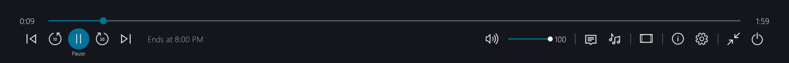
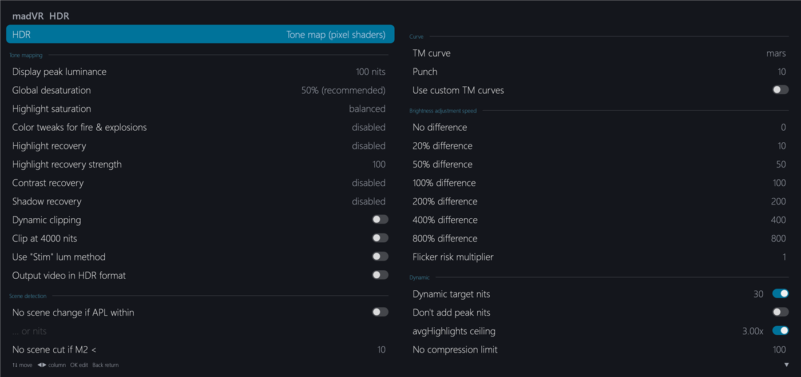
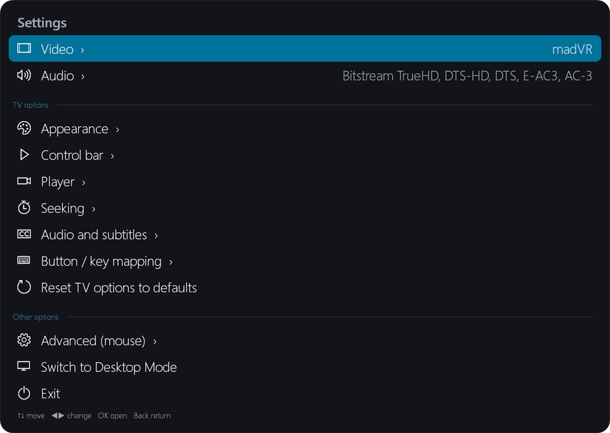
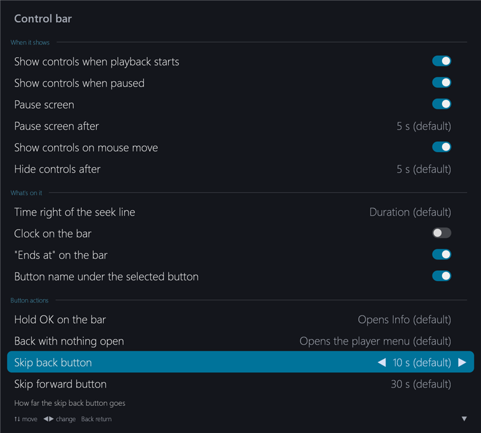
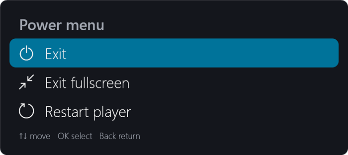
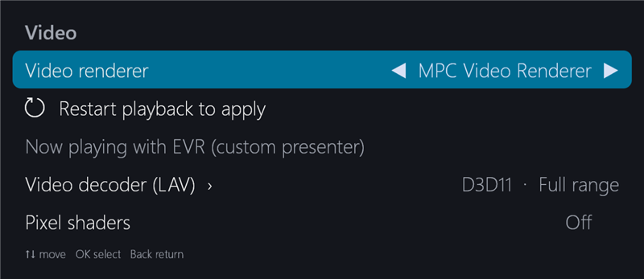

  <picture>
    <source media="(prefers-color-scheme: dark)" srcset="../docs/screenshots/logo-dark.png">
    
  </picture>

  <b>MPC-HC with a remote-friendly TV Mode.</b> 
  Arrows, OK and Back drive everything, drawn over madVR or any other renderer.

  <a href="https://github.com/fshometheater/mpc-hc-tv/releases"><b>Download</b></a> ·
  <a href="#features">Features</a> ·
  <a href="#getting-started">Getting started</a> ·
  <a href="../BUILD.md">Building</a>

---

MPC-HC TV is a fork of [MPC-HC](https://github.com/clsid2/mpc-hc) (clsid2) 2.8.5 that adds a **TV Mode**:
a full-screen overlay for watching from the couch with a remote. Everything works with arrows, OK and
Back, and with the mouse too. Outside TV Mode it is the normal MPC-HC: its menus, keys, Options dialog
and web interface are unchanged.

> **Development build.** This is an early version (0.1.0). Settings and behaviour may still change
> between builds. Feedback and bug reports are welcome in the Issues.

> **madVR:** TV Mode's madVR pages were made and tested with **madVR 0.92.17 test build 210**
> (madshi's HDR measurement build):
> [announcement on AVS Forum](https://www.avsforum.com/posts/64465710/) ·
> [download (madVRhdrMeasure210.zip)](https://madshi.net/madVRhdrMeasure210.zip).
> The standard 0.92.17 release may store some settings differently, so not every madVR option may show
> or work with it. Everything else in TV Mode works with any renderer.

## Features

### Control bar
- Seek line with chapter marks and the chapter name, elapsed time and length or time left, clock and
  "Ends at".
- Transport (previous, skip back, play / pause, skip forward, next), volume with a slider, then
  **Subtitles**, **Audio**, **Chapters**, **Video**, **Info**, **Settings**, **Fullscreen** and **Power**.
- Show, hide and reorder buttons and add separators in the button editor.
- **Smooth seeking**: a tap moves one step; holding glides the preview every frame and speeds up.
  The jump happens after a short pause, right away, or after OK (Back cancels).
- Smooth playhead, chapter snapping, a chapter list, and a pause screen with the title and times.

### Audio and subtitles
- Track lists with language, title, codec or format, channel layout and default / forced flags; the
  current track is marked and the list opens on it. Subtitles start with "Off" and say whether a track
  is embedded or an external file.
- Audio and subtitle delay in the same lists (OK resets to 0).
- A subtitle style page (font, size, colour, opacity, outline, shadow, position).
- MPC-HC's own automatic track selection by preferred language is untouched.

### Info
- Video and audio panels: badges (4K, HDR10, Dolby Vision, Atmos ...), source next to output, the
  display mode and HDR state, decoders, bitstreaming, and the HDMI signal on NVIDIA cards.
- Three levels: Basic, Extended and Nightmare (everything MediaInfo knows).
- Works for streams too: when a media server passes a web address instead of a file, the title and
  MediaInfo details are read from the stream.

### Video, madVR and LAV
- **Video page**: video renderer, madVR settings, LAV Video, pixel shaders. After changing the
  renderer, "Restart playback to apply" reopens the file at the same place with the same tracks.
- **madVR panel**: picture (HDR, scaling refinement, smooth motion, trade quality for performance),
  display (calibration, display modes, frame rate matching) and tools, edited live with a mini view so
  the picture stays visible. On / off options are switches (OK or a click flips them); options with an
  on / off and a value keep both on one row.
- **LAV pages**: bitstreaming, DRC, output formats, hardware decoding, RGB levels, deinterlacing.

### TV options
- **Look**: accent colour (presets or custom), background colour, menu and bar opacity, icon
  brightness, menu and bar size, font, animation speed (Off to Slowest).
- **Control bar**: when it shows (start, pause, mouse), what's on it, Hold OK, skip distances.
- **Player**: **Resume the last file on start** (started on its own, with no file from a media server,
  Explorer or the command line, the player carries on with the last file if it was stopped part-way),
  the pause screen, what Back does when nothing is open, and MPC-HC's own *remember file position*,
  *open in fullscreen*, *leave fullscreen at the end* and *after playback*, changed from the remote.
- **Seeking**: step, hold speed-up, smooth scrubbing, chapter snapping, MPC-HC's jump distances.
- **Button / key mapping**: any key for any command, including holds (0.6 s, OK included) and the arrow
  keys, so a remote with few buttons goes a long way. Set, Set hold, Edit and Clear work from the
  remote itself; Edit shows a command's keys as tags so one can be removed and the others kept.
- Menus wrap around, scroll smoothly with the mouse wheel, and skip options that don't apply.

  
  

### Power menu
- Back with nothing open opens the **power menu**: Exit, Enter / Exit fullscreen, Restart player.
  (It can also be set to leave fullscreen or exit the player directly.)
- The **Power** button in the bar's corner opens it too.

  
  

### Drawing
- **Own window** (default): drawn over the video with any renderer (madVR, MPC Video Renderer, EVR),
  animated at the display's refresh rate.
- **Inside madVR**: drawn into madVR's own picture, which keeps working in HDR passthrough and
  exclusive fullscreen.

## Getting started

1. Download the installer or the portable zip from the
   [releases](https://github.com/fshometheater/mpc-hc-tv/releases) (64-bit or 32-bit).
2. The installer's **"Apply recommended TV settings"** (ticked by default) turns on TV Mode with the TV
   layout, fullscreen on open, the dark theme, the TV logo, the TV subtitle style and *Resume the last
   file on start*. It also turns on MPC-HC's *remember file position*; if a media server handles
   resume, untick the box or switch that option off afterwards.
3. Turn TV Mode on or off any time: start with `/tv`, View > TV Mode, or View > Presets > **TV** (key 5)
   / **TV Minimal** (key 6, borderless).
4. Open the control bar with **Down** (or the key you set), move with the arrows, OK selects, Back goes
   back.
5. With no file loaded, a click on the player opens the last file from the recent files (a file picker
   if there is none).

madVR is not included; install it the usual way and select it under Options > Playback > Output. For
the madVR pages use **madVR 0.92.17 test build 210**
([download](https://madshi.net/madVRhdrMeasure210.zip),
[announcement](https://www.avsforum.com/posts/64465710/)); see the note at the top.

### Using it from a media server
Set the media server's external player (Emby, Jellyfin and others) to `mpc-hc64.exe` with `/tv`.
MPC-HC's web interface (port 13579, `/variables.html`) works as before, so scripts that read
`position`, `duration` and `state` keep working.

### Updates
Update checks are off by default; the installer has an option, and Options > Miscellaneous changes it
later. The player compares its own version (MPC-HC TV 0.1.0) with this repository.

## Building

See [BUILD.md](../BUILD.md). In short: Visual Studio 2022 or 2026 with the v143 tools, the player
project only, and the LAV Filters, translations and MediaInfo from the official MPC-HC release of the
same version. Making release packages is in [docs/RELEASE.md](../docs/RELEASE.md).

Most TV code lives in the new `src/mpc-hc/Tv*.cpp` / `Tv*.h` files; changes to MPC-HC's own files are
small and marked `TV MODE`, so new MPC-HC releases merge in easily.

## Licence and credits

MPC-HC TV is based on [MPC-HC](https://github.com/clsid2/mpc-hc) by clsid2 and the MPC-HC team, and like
MPC-HC it is licensed under the **GPL-3.0** (see [COPYING.txt](../COPYING.txt)). The packages include
[LAV Filters](https://github.com/clsid2/LAVFilters), [MediaInfo](https://mediaarea.net/MediaInfo) and
[MPC Video Renderer](https://github.com/Aleksoid1978/VideoRenderer) as shipped with MPC-HC.

Not affiliated with MPC-HC, madVR, LAV Filters, Emby or Jellyfin. The track lists follow the look and
behaviour of Emby's and Jellyfin's players; no code, icons or fonts were taken from them.
